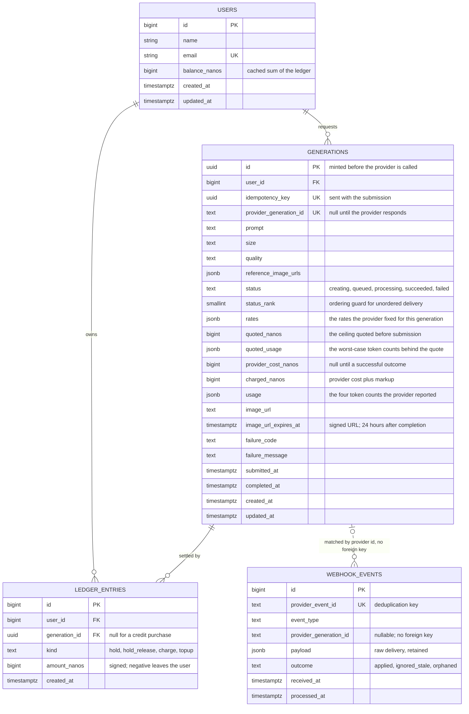

# Entity relationship model

The data model is four tables. Most of the correctness guarantees this application makes are enforced here rather than in application code, so this document explains what each table holds, which constraint protects what, and why three of the modelling choices are not the obvious ones.

[ARCHITECTURE.md](ARCHITECTURE.md) covers how the code around this model is organised, and [SYSTEM-DESIGN.md](SYSTEM-DESIGN.md) covers how it behaves at runtime.

---

## Diagram

---

## Entities

### users

Standard authentication, plus a single additional column.

`balance_nanos` is a **cache**, not the source of truth. The authoritative balance is `SUM(ledger_entries.amount_nanos)` for that user. The cache is maintained in the same transaction as the entry that changes it, and an artisan command asserts the two agree. Keeping a cached column avoids aggregating the whole ledger on every page load; keeping the ledger authoritative means a disagreement is detectable rather than silent.

### generations

One row per request a user makes, created **before** the provider is contacted. A generation that is never accepted still has a row, which is what gives a webhook somewhere to land and the reconciler something to find.

Five columns deserve explanation:

| Column | Why it exists |
|---|---|
| `idempotency_key` | Sent with the submission. A request that times out has an unknown outcome, not a failed one; the key makes retrying it safe rather than a second generation the user pays for. |
| `status_rank` | A denormalised copy of the status ordering. Webhook delivery is unordered, and comparing ranks in the `UPDATE` makes "only move forward" a condition the database evaluates rather than a rule the application remembers. |
| `quoted_nanos` and `charged_nanos` | Both are kept. The quote is the ceiling the user agreed to and the charge is what they paid; overwriting one with the other would destroy the ability to explain a difference. The quote is deliberately a ceiling rather than an expectation: two of the four token counts are only known once a generation completes, so no exact figure exists beforehand, and a quote that could be exceeded is not one a user can rely on. |
| `provider_cost_nanos` | What the provider billed, held separately from what the user was charged, so profit is a stored subtraction and reconciliation against `GET /v1/usage` is a direct comparison. |
| `rates` | The provider fixes a generation's rates when it creates it and returns them on the create response. Published rates can change; these cannot. Recording them is what keeps a charge reproducible and lets a cost from months ago still be explained. |

`usage` and `quoted_usage` retain the token counts behind each figure, so any price can be re-derived from the inputs that produced it.

`failure_code` and `failure_message` are separate because they serve different readers: the code is what the application branches on and groups by, the message is what a user is shown.

### ledger_entries

Append-only. Nothing is ever updated or deleted; a correction is a new compensating entry.

| Kind | Sign | Written when |
|---|---|---|
| `topup` | positive | A user adds credit |
| `hold` | negative | A generation is submitted, reserving the estimate |
| `hold_release` | positive | The generation reaches an outcome, releasing the reservation |
| `charge` | negative | The generation succeeds, for the actual cost |

A successful generation therefore produces a `hold`, a `hold_release` and a `charge`; a failed one produces a `hold` and a `hold_release`, netting to zero. This is the authorise-and-capture pattern used for card payments, and it is why a failed generation genuinely costs nothing rather than costing something that is later refunded.

### webhook_events

A transactional inbox. Every delivery that passes signature verification is recorded before anything acts on it, and the unique constraint on `provider_event_id` is what makes a repeated delivery a no-op.

`payload` keeps the raw delivery indefinitely. When a figure is questioned later, the provider's own words about that generation are still on file.

`outcome` records what processing decided: `applied`, `ignored_stale` for an event superseded by one that had already arrived, `orphaned` for an event whose generation could not yet be identified, or `acknowledged` for a `ping` — the provider's dashboard test event, which is valid and about no generation. None of the four is a failure; an event that cannot be verified never reaches this table at all.

Deliveries that fail signature verification are rejected and **not** stored. Storing unauthenticated input invites a writable table reachable by anyone who knows the endpoint.

---

## Indexes

| Index | Kind | Serves |
|---|---|---|
| `webhook_events (provider_event_id)` | unique | Deduplication. The failed insert on a repeated delivery is the mechanism, not an error to handle. |
| `ledger_entries (generation_id, kind) WHERE generation_id IS NOT NULL` | partial unique | A second charge for a generation is refused by the database. Partial because credit purchases have no generation. |
| `generations (provider_generation_id)` | unique | Webhook lookup, and prevents a retried submission registering twice. |
| `generations (idempotency_key)` | unique | One submission per key. |
| `generations (user_id, created_at)` | composite | The history view. Columns in that order so one index serves both the filter and the sort. No descending variant is needed: Postgres traverses a b-tree in either direction, so this also satisfies `ORDER BY created_at DESC`. |
| `generations (submitted_at) WHERE status IN ('creating','queued','processing')` | partial | The reconciler. Rows leave the index when they reach an outcome, so it stays the size of the in-flight set regardless of how large the table grows. |
| `webhook_events (provider_generation_id)` | plain | Matching a delivery to its generation, and finding orphans once an identifier is known. |
| `webhook_events (received_at) WHERE processed_at IS NULL` | partial | The unprocessed backlog, oldest first. A processed event is never looked up this way. |
| `ledger_entries (user_id, created_at)` | composite | Balance derivation and the per-user daily grouping in the operator report. |

The two partial indexes are the ones that change behaviour at scale. Their plain equivalents would grow with the table and spend most of their size on rows that will never be read through them again — generations that have already reached an outcome, and events that have already been handled.

---

## Check constraints

Vocabularies and invariants are held in the schema as well as in the enums above it, so no path — a migration, a console command, a direct `UPDATE` — can write a row the application would consider impossible.

| Constraint | Refuses |
|---|---|
| `generations_status_check` | A status outside the five the lifecycle defines |
| `generations_status_rank_check` | A rank outside 0–3 |
| `generations_amounts_non_negative_check` | A negative estimate, provider cost or charge |
| `generations_costs_match_outcome_check` | A succeeded generation with no recorded cost, or an unsuccessful one that carries a charge |
| `ledger_entries_kind_check` | A kind outside the four the ledger defines |
| `ledger_entries_direction_check` | An entry whose sign contradicts its kind — a charge that credits a user, or a top-up that debits one |
| `ledger_entries_generation_required_check` | Any entry other than a top-up that settles no generation |
| `webhook_events_outcome_check` | An outcome outside `applied`, `ignored_stale` and `orphaned` |

`generations_costs_match_outcome_check` is the one that does the most work. A generation is either priced and successful or unpriced and not, which makes a half-applied outcome — a status written without its costs, or costs written without the status — impossible to record rather than merely unlikely.

---

## Modelling decisions

### webhook_events has no foreign key to generations

A webhook can arrive before the generation row carries a provider identifier — the provider can dispatch its first event before the response to the submission has been written. A foreign key would reject exactly the event that most needs keeping, and the endpoint would have to answer with an error, which the provider would treat as a reason to redeliver indefinitely.

The association is therefore resolved in application code, and an event that cannot yet be matched is stored with `outcome = 'orphaned'` and retried by the reconciler once the identifier is known.

### Money is stored as bigint nanodollars, not numeric

Postgres `NUMERIC` would hold these values exactly. Integers were chosen because the guarantee then extends beyond the database: a `bigint` arrives in PHP as an `int` and cannot be silently coerced into a float by an arithmetic operation, whereas a `NUMERIC` arrives as a string and the first careless `+` turns it into one.

The unit is set by what the provider bills in. It reports costs to nine decimal places and states that amounts are never rounded, and one of its four rates — $12.50 per million reasoning tokens — works out at 12.5 micro-dollars per token. A cent-based or micro-dollar column could not hold that, and would lose real money on every generation.

In nanodollars every published rate is a whole number per token, so a provider cost is a sum of integer products with nothing to round, and a recorded cost compares against the provider's own reporting digit for digit rather than within a tolerance.

### A balance may go negative, and no constraint forbids it

A hold reserves the quoted ceiling, which the actual cost should not exceed — that is the point of quoting a ceiling rather than an expectation. It can still happen: the provider states the real text token count falls within 15% of the estimate, and a prompt whose characters tokenise worse than the published ratio can push past the band. When it does, the release returns the held amount and the charge takes the true one, which can leave the balance slightly below zero.

Refusing the charge would be the worse outcome. The provider has already billed for the work, so the obligation exists whether or not it is recorded, and a constraint rejecting it would fail the transaction that is trying to record the truth. The hold bounds the exposure; it does not eliminate it.

### status and status_rank are both stored

This is deliberate denormalisation. `status` is what the application and the interface read; `status_rank` exists so the transition guard can be expressed as a comparison inside the same statement that performs the update, rather than as a read followed by a decision followed by a write. The two are set together in one place, by the state machine in `App\Domain\GenerationStatus`.

---

## A generation, row by row

**A generation that succeeds**

| Step | Table | Effect |
|---|---|---|
| User submits | `generations` | Row inserted: `status = creating`, `quoted_nanos` set |
| | `ledger_entries` | `hold` for the quoted ceiling |
| Provider accepts | `generations` | `provider_generation_id`, `rates` and `submitted_at` set, `status = queued` |
| `processing` webhook | `webhook_events` | Stored, `outcome = applied` |
| | `generations` | `status = processing` |
| `succeeded` webhook | `webhook_events` | Stored, `outcome = applied` |
| | `generations` | `status = succeeded`, costs and `image_url` recorded |
| | `ledger_entries` | `hold_release`, then `charge` for the actual cost |
| Same webhook redelivered | `webhook_events` | Insert refused by the unique constraint. Nothing else happens. |

**A generation that fails**

Identical until the outcome, which writes `status = failed` and a `failure_reason`, releases the hold, and writes **no** `charge`. The ledger nets to zero and the user has paid nothing.
