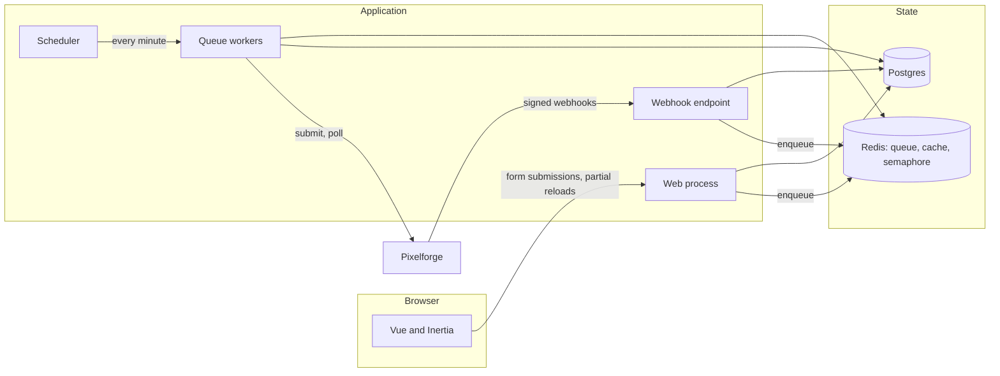
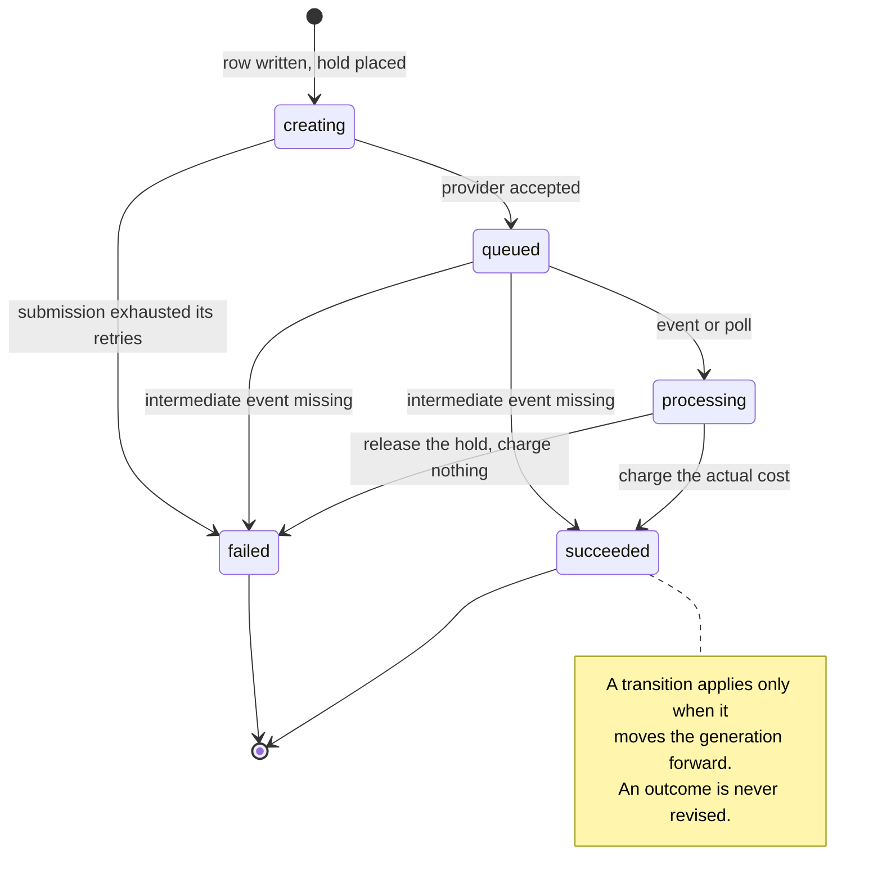

# System design

How the system behaves at runtime: the components and the boundaries between them, the two lifecycles that matter, what happens when each part fails, and what constrains it under load.

This is the behavioural view. [ARCHITECTURE.md](ARCHITECTURE.md) covers how the code is organised, and [ERD.md](ERD.md) covers the data model.

---

## Components



Four processes, deployed from one codebase:

| Process | Responsibility | Why it is separate |
|---|---|---|
| Web | Renders pages, accepts submissions | Must stay responsive; does no provider I/O |
| Webhook endpoint | Verifies, records, acknowledges | Must answer quickly, so it does no work beyond persisting the delivery |
| Queue workers | Calls the provider, applies events, writes the ledger | Restarting or scaling these must not interrupt the web tier |
| Scheduler | Triggers reconciliation | A single clock, separate from the workers it dispatches to |

The web process never calls the provider. A provider that is slow would otherwise make the application slow, and a provider that is down would make it unavailable.

---

## Submitting a generation

The ordering of the first two steps is the design decision, not an implementation detail.

```mermaid
sequenceDiagram
    autonumber
    participant U as User
    participant W as Web
    participant DB as Postgres
    participant Q as Queue
    participant P as Pixelforge

    U->>W: POST /generations
    W->>DB: INSERT generation (status=creating) + hold on the ledger
    Note over W,DB: The row is committed before any network call,<br/>so an early webhook has something to match
    W-->>U: Redirect; the generation is already visible
    W->>Q: SubmitGenerationToProvider

    Q->>P: POST /v1/generations (Idempotency-Key, semaphore-gated)
    alt 429 or 503
        P-->>Q: rate limited or overloaded
        Q->>Q: backoff with full jitter, honouring Retry-After
    else timeout
        Note over Q: Outcome unknown, not failed.<br/>Never resubmitted without the idempotency key
    end
    P-->>Q: 202 Accepted + provider id
    Q->>DB: UPDATE provider_generation_id, status=queued
```

If every retry is exhausted, the generation is marked `failed` with a reason, the hold is released, and nothing is charged.

---

## Receiving a webhook

```mermaid
sequenceDiagram
    autonumber
    participant P as Pixelforge
    participant H as Webhook endpoint
    participant DB as Postgres
    participant J as Worker

    P->>H: POST /webhooks/pixelforge
    H->>H: Verify HMAC over the raw body
    H->>H: Check the timestamp is inside tolerance
    H->>DB: INSERT webhook_events (provider_event_id UNIQUE)

    alt Already seen
        DB-->>H: unique violation
        H-->>P: 200 OK, nothing further happens
    else New delivery
        H->>J: ProcessWebhookEvent
        H-->>P: 200 OK
        J->>DB: BEGIN; SELECT generation FOR UPDATE
        alt No matching generation yet
            J->>DB: outcome = orphaned
        else Event is stale
            J->>DB: outcome = ignored_stale
        else Succeeded
            J->>DB: status, costs, image; hold_release + charge
        else Failed
            J->>DB: status and reason only; hold_release, no charge
        end
        J->>DB: COMMIT
    end
```

Verification happens before anything is stored, and acknowledgement happens before any work is done. A slow acknowledgement produces a timeout at the provider, and a timeout produces a redelivery — so an endpoint that does its work before answering generates the very duplicates it then has to defend against.

### Three problems, three mechanisms

These are easily conflated, and conflating them is the usual source of duplicate charges.

| Problem | Example | Mechanism |
|---|---|---|
| The same event, twice | A redelivery after a timeout | Unique index on `provider_event_id` |
| Different events, wrong order | `processing` arriving after `succeeded` | Rank comparison in the state machine |
| The same event, concurrently | Two workers, one generation | `SELECT … FOR UPDATE` |

Charging is additionally protected by a unique index on `(generation_id, kind)`. The inbox and that constraint fail independently, so a replay, a manual redelivery from the provider's dashboard, or the reconciler racing a webhook is refused by the database rather than by application logic.

---

## Generation lifecycle



---

## Reconciliation

Webhooks can be lost, delayed, or delivered before the system can identify what they refer to. A scheduled command closes each of those gaps, every minute:

| Condition | Action |
|---|---|
| Not terminal, submitted over 60 seconds ago | Poll the provider and apply the result |
| Event stored as `orphaned` | Attempt to match it again |
| Not terminal, over 30 minutes old | Mark failed, release the hold, charge nothing |

It applies results through the same action the webhook handler uses. Two implementations of one state transition would drift apart, and the drift would surface as a double charge.

---

## Failure modes

| Failure | What the user sees | How the system recovers |
|---|---|---|
| Provider rate limits a submission | Nothing; it is queued | Backoff honouring `Retry-After` |
| Provider is overloaded | Nothing; it is queued | Exponential backoff with full jitter |
| Provider concurrency limit reached | Nothing; it is queued | Semaphore releases the job back to the queue rather than holding a worker asleep |
| Submission times out | Generation stays pending | Treated as an unknown outcome. The idempotency key makes a retry safe; the reconciler resolves it |
| Webhook never arrives | Status resolves within a minute | Reconciler polls the provider |
| Webhook arrives before the submission response | Nothing | Event stored as `orphaned`, matched by the reconciler |
| Webhook delivered twice | Nothing | Unique constraint refuses the second insert |
| Webhooks delivered out of order | Nothing | Rank comparison ignores the stale event |
| Generation fails at the provider | Marked failed, with a reason, at no cost | Hold released, no charge written |
| Worker dies mid-transaction | Nothing | The transaction rolls back; the job is retried |
| Redis unavailable | Submissions cannot be queued | Web tier and history remain readable; Postgres holds all state |
| Postgres unavailable | Application is down | No partial state: nothing is recorded outside the database |

The pattern throughout: the system degrades toward *nothing happened* rather than toward *something happened twice*.

---

## Concurrency

Contention is per generation and per user, never global.

| Contended resource | Strategy | Why that one |
|---|---|---|
| A single generation during event processing | Row lock held for the transaction | The critical section spans several reads and writes |
| A user's balance at submission | `UPDATE … WHERE balance_micros >= :amount`, checking the affected row count | The check and the deduction collapse into one atomic statement, holding no lock across application code |
| In-flight calls to the provider | Redis semaphore | A concurrency limit constrains simultaneous requests, which backoff alone does not address |
| One generation submitted twice | `WithoutOverlapping` keyed on the generation | Prevents a duplicate submission before the provider ever sees it |

Different shapes of contention take different tools. Using a row lock for the balance would hold it across the affordability decision for no benefit; using a conditional update for event processing would not cover a multi-statement section.

---

## Behaviour under load

What binds first, in order:

1. **The provider's concurrency limit.** The semaphore caps in-flight requests, so additional load queues rather than failing. Throughput is bounded by the provider, not by this application.
2. **Queue workers.** Horizontal, with `--scale worker=N`. Workers share no state beyond Postgres and Redis.
3. **The web tier.** Stateless and horizontally scalable; sessions are in Postgres.
4. **Postgres writes.** Reached long after the three above. The partial index on in-flight generations keeps reconciliation independent of total table size.

The known limit is the operator report, which aggregates the ledger live. Beyond a few million entries that should become a daily rollup table, written once per day and read thereafter. It is not worth building before the data exists to justify it.

---

## Trust and secrets

| Boundary | Control |
|---|---|
| Webhook endpoint, publicly reachable | HMAC verification over the raw request body, compared in constant time, before anything is parsed or stored |
| Replayed deliveries | Rejected outside a five-minute timestamp window, independent of deduplication |
| Unauthenticated requests | Rejected and not persisted; the inbox never holds unverified input |
| API key and signing secret | Environment only, never in the repository. One key per environment, so usage reporting for the deployed application is separate and reconcilable |
| User data | Generations and ledger entries are scoped to their owner at the query level |

The webhook route is exempt from CSRF, since the provider is not a browser session, and no middleware re-serialises the body — a re-encoded payload produces different bytes and fails every signature check.

---

## What is observable

- Every webhook delivery is retained with its raw payload and the outcome processing decided, so any disputed figure can be traced to what the provider actually sent.
- Every movement of money is an immutable ledger entry; balances are derived, and a command asserts the cached balance matches the ledger.
- Each generation stores both the estimate and the final charge, with the token counts behind each, so a difference between them can be explained rather than guessed at.
- The operator report compares recorded provider costs against the provider's own usage endpoint and shows the difference, which makes a drift in pricing visible rather than something discovered in a monthly invoice.
